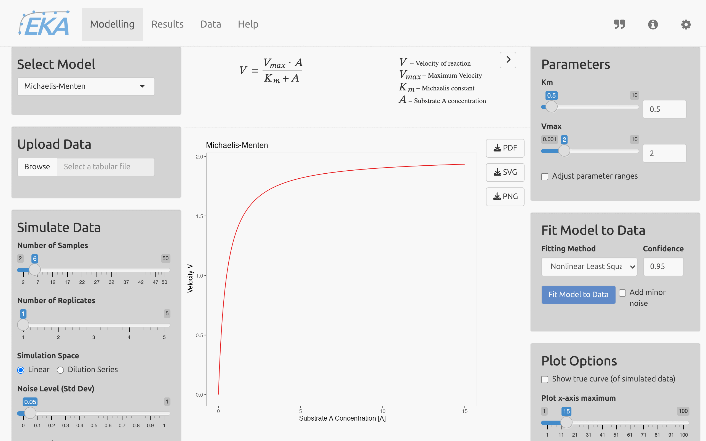
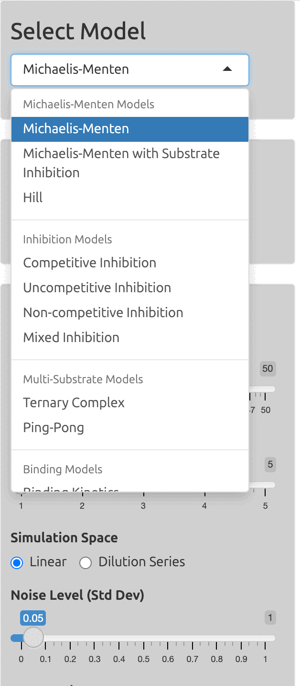
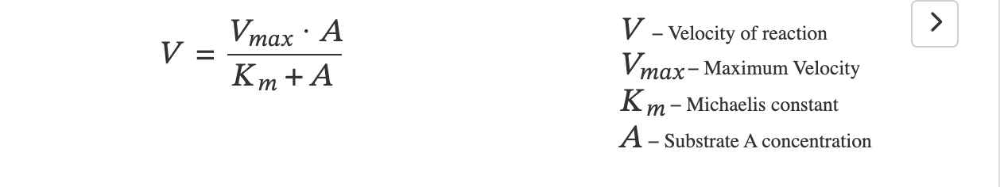
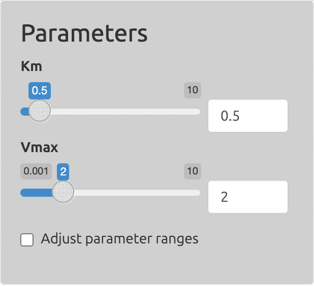
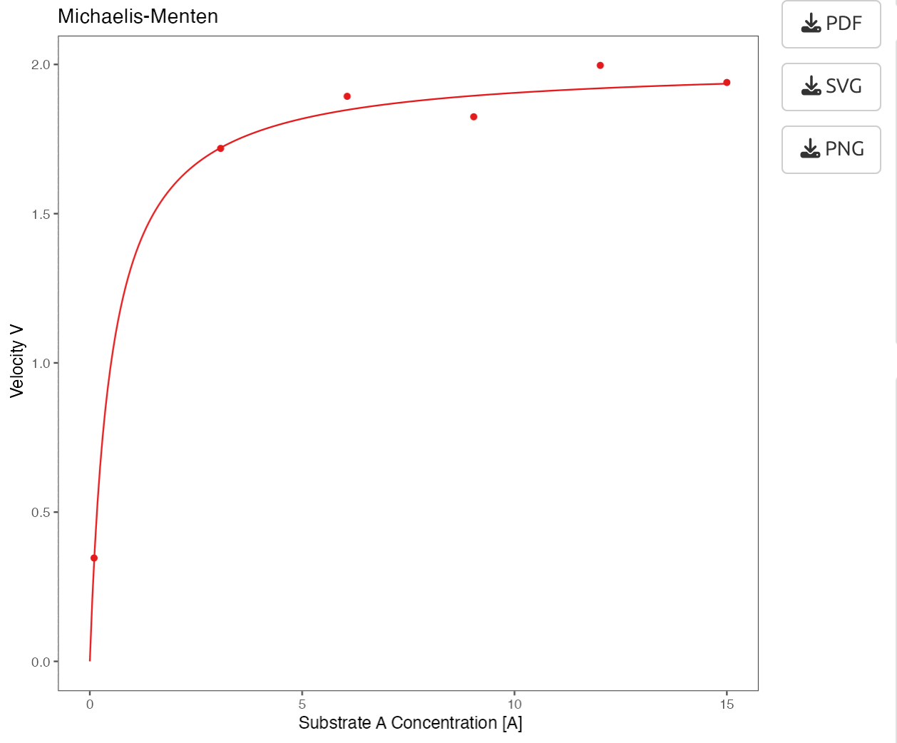
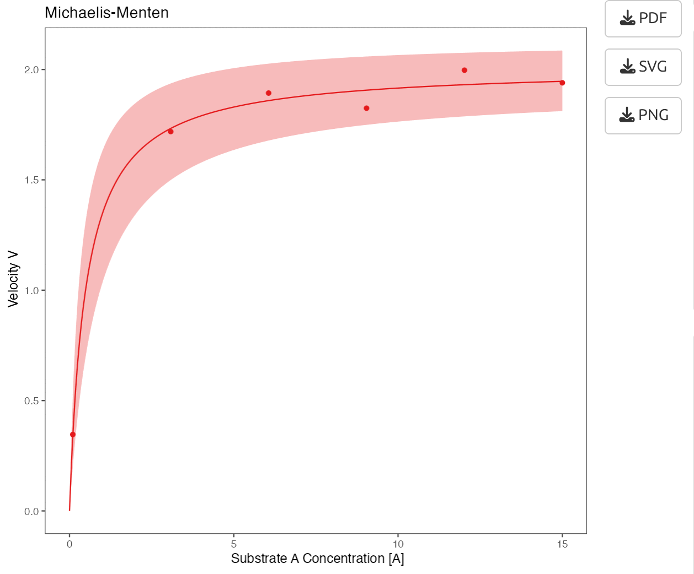
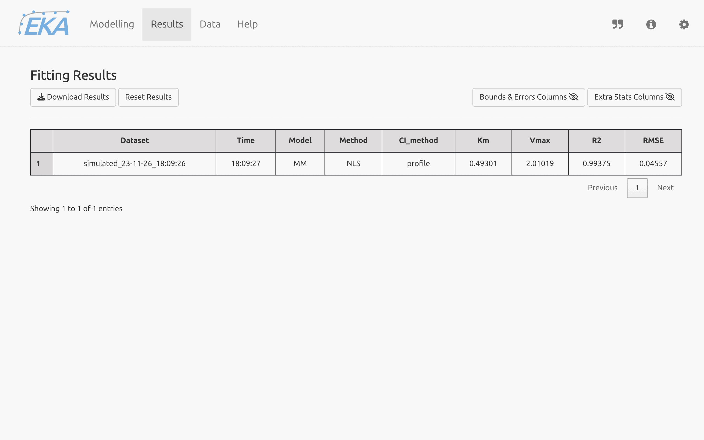

EKA2 is a free web app for enzyme kinetics. It needs no installation or account: open **[eka.nz](https://eka.nz)** in a browser on a laptop or desktop computer. This page takes you through a first analysis in about five minutes. The [user guide](user-guide.html) covers everything in more detail.

## 1. Open EKA2

EKA2 opens on the **Modelling** tab, with the Michaelis-Menten model selected and its curve drawn. The left column is for getting data (uploading or simulating it), the centre shows the model and the plots, and the right column holds the parameters, fitting and plot options.

{.eka-shot width=100%}

## 2. Choose a model

Pick a model from the **Select Model** menu at the top left. The models are grouped into Michaelis-Menten, inhibition, multi-substrate and binding models. For now, keep Michaelis-Menten.

{.eka-shot width=314}

The model's equation and the meaning of each symbol appear above the plot:

{.eka-shot width=629}

## 3. Explore the model

The **Parameters** panel on the right has a slider and a box for each parameter. Drag the Km or Vmax slider and the curve redraws as you go. You can also type a value in a box and press Enter. Try making Km larger: the curve rises more slowly, and reaches half of Vmax at A = Km.

{.eka-shot width=309}

## 4. Simulate an experiment

In the **Simulate Data** panel, click **Simulate Data**. EKA2 picks substrate concentrations across the data x-axis range, calculates the rate at each from the current parameter values, and adds random noise, as a real experiment would have. The points appear on the plot, and a residual plot appears beneath it.

{.eka-shot width=629}

## 5. Fit the model

Now fit the model to the data. In the **Fit Model to Data** panel, click **Fit Model to Data**. EKA2 finds the parameter values that best match the data, starting from the current slider values, and moves the sliders to the fitted values. The shaded band is the parameter uncertainty envelope: how far the curve moves when each parameter is at the edge of its 95% confidence interval.

{.eka-shot width=629}

## 6. Read the results

Open the **Results** tab. Each fit adds a row with the fitted parameters and the method used. The buttons at the top right show the confidence bounds, standard errors and more statistics. **Download Results** saves the table as a CSV file.

{.eka-shot width=100%}

## Next steps

- **Use your own data:** drag a CSV or Excel file onto **Upload Data**. To practise first, download this [sample Michaelis-Menten data](../../data/michaelis-menten.csv) and upload it. See [Uploading data](user-guide.html#uploading-data).
- **Try other models:** switch to an inhibition model and look at the curves for different inhibitor concentrations.
- **Turn on Advanced Mode** in **Options** (the cog at the top right) for more plots, noise settings, parameter locking and plot styling.
- **Read the [user guide](user-guide.html)** for every feature, and [Enzyme Kinetics Concepts](../concepts/models.html) for the science behind them.
