EKA2 is a free web app for enzyme kinetics at **[eka.nz](https://eka.nz)**. It simulates, fits and plots 14 models of enzyme and binding kinetics, with no installation or account. It runs on [enzKinet2](../enzKinet2.html), the R package that these docs also cover, so everything EKA2 does can be repeated in R. New to EKA2? Start with the [quick start](quick-start.html).

## Using EKA2

Open [eka.nz](https://eka.nz) in an up-to-date browser on a laptop or desktop computer. EKA2 is laid out for a wide screen; it works on a phone or tablet, but small.

- **Your session is private.** Each visitor gets their own copy of EKA2. Your data and results are kept only while your session is open, and nothing is saved afterwards. Download anything you want to keep (see [Results](#results) and [The Data tab](#the-data-tab)).
- **Sessions end.** A session closes after 45 minutes without any activity, and after 4 hours at most. Reload the page to start a new one.
- **Capacity.** EKA2 runs a limited number of sessions at once. If it's full, you'll see "The server does not have enough capacity to start this app, please try again later." Try again in a few minutes.

## The layout

EKA2 has four tabs: **Modelling**, where nearly all the work happens, **Results**, **Data** and **Help**. The three buttons at the top right open **How to cite**, **About** and **Options**.

{.eka-shot width=100%}

The Modelling tab has three columns:

- **Left:** choosing a model, and getting data by uploading or simulating it.
- **Centre:** the model's equation and symbols, the main plot and, once there is data, the residual plot. The **›** button at the top right of the centre hides the right column, giving the plots more room.
- **Right:** the parameters, fitting, and plot options.

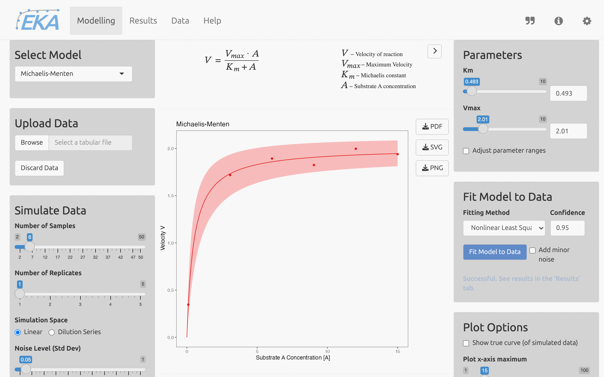{.eka-shot width=100%}

**Basic and Advanced Mode.** EKA2 starts in Basic Mode, which shows the essentials. Advanced Mode, in **Options**, adds more models, plot types, noise settings, parameter locking and plot styling. Where a feature below needs Advanced Mode, it says so. See [Advanced Mode](#advanced-mode).

## Choosing a model

Choose a model from the **Select Model** menu. The models are grouped into Michaelis-Menten models, inhibition models, multi-substrate models and binding models. Original Michaelis-Menten and Alternative Michaelis-Menten appear only in Advanced Mode.

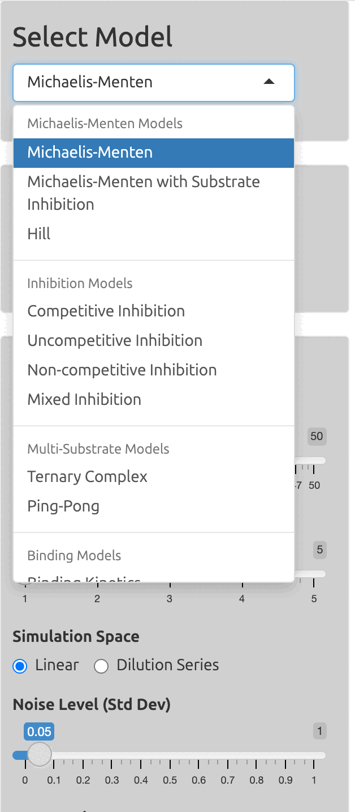{.eka-shot width=314}

Switching to a model with different variables (say, from Michaelis-Menten to an inhibition model) discards the current data, and switching models always clears the true curve and the envelope. The model's equation and the meaning of each symbol are always shown above the plot. The [model gallery](../concepts/models.html) has every model's equation, parameters and data requirements.

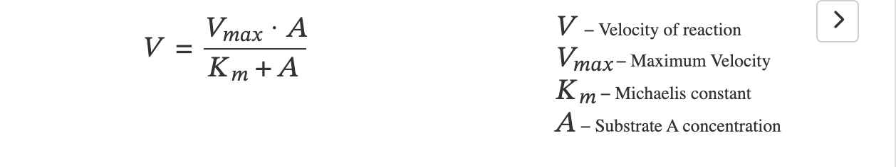{.eka-shot width=629}

## Parameters

The **Parameters** panel has a slider and a box for each of the model's parameters. Moving a slider redraws the curve straight away, so you can see what each parameter does. A value typed in a box is applied when you press Enter or leave the box. While you hold a slider, the y-axis stays still so the curve doesn't jump about.

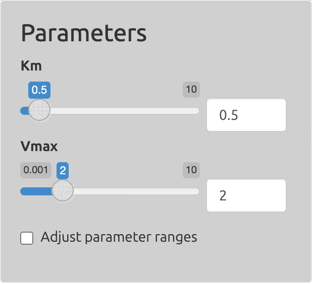{.eka-shot width=309}
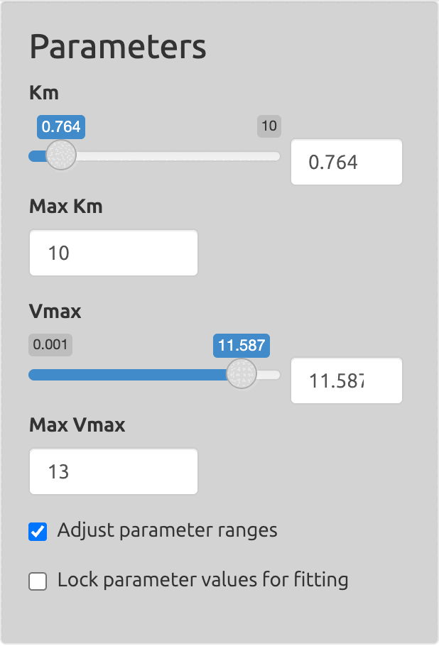{.eka-shot width=309}

- **Slider ranges.** Typing a value above a slider's maximum extends the slider. **Adjust parameter ranges** shows a box for each slider's maximum. The sliders move in steps of 0.001 and can't go below 0.001, so choose units that keep your parameters well above that (for example mM or µM rather than M). The Results tab keeps the unrounded estimates.
- **The parameter values are used everywhere.** They draw the curve, they're the parameters used to simulate data, and they're the starting point for fitting. A fit writes its results back to the sliders.
- **Locking parameters** (Advanced Mode). **Lock parameter values for fitting** lets you choose parameters to hold at their current values while the others are fitted. Original and Alternative Michaelis-Menten need E0 locked to the enzyme concentration you used, because rates alone can't separate Kcat from E0.

### Models with an extra variable

Inhibition models have an inhibitor concentration I, the two-substrate models a second substrate B, and Quadratic Binding Kinetics a limiting partner concentration R. For these, a box at the bottom of the Parameters panel sets the concentrations to use, separated by commas. By default they're 0, 0.5, 1.0, 2.0, 4.0 for I, so there's an uninhibited curve to compare with, and 0.5, 1.0, 2.0, 4.0, 8.0 for B and R. The plot draws one curve per concentration, in its own colour.

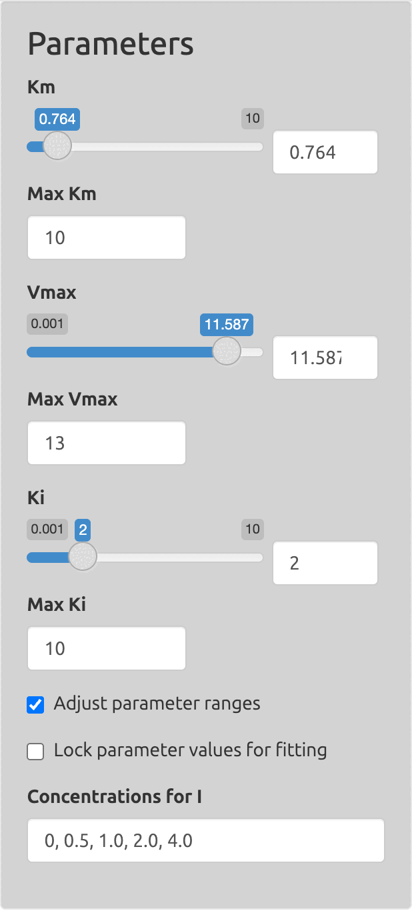{.eka-shot width=309}
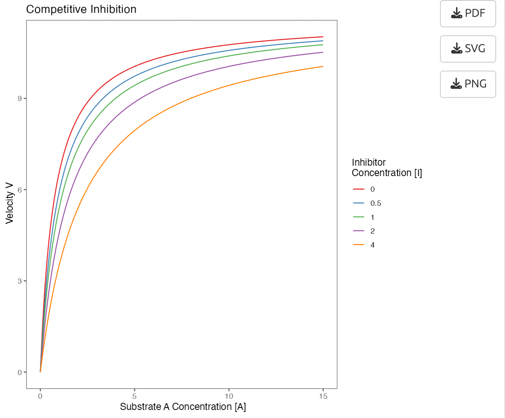{.eka-shot width=440}

## Simulating data

Simulating data generates an experiment's worth of data from the current model and parameter values, with random noise added, as real measurements would have. It's useful for learning, and for planning experiments: see [Simulation and noise](../concepts/simulation.html).

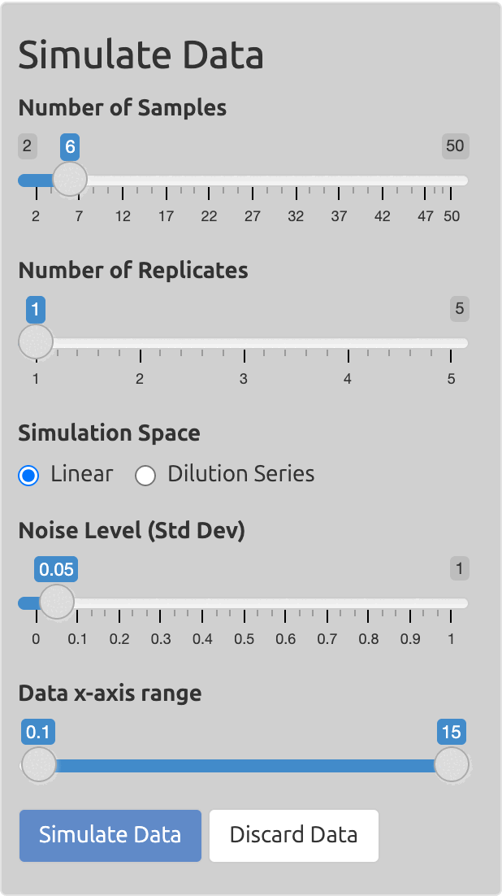{.eka-shot width=309}
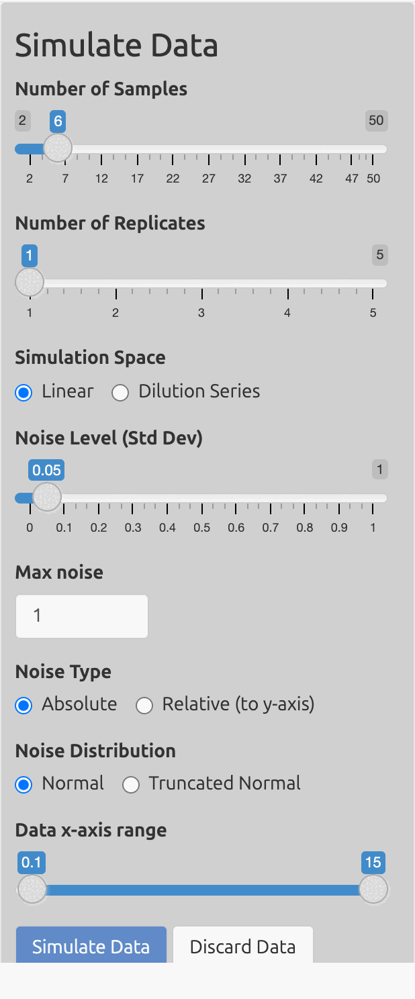{.eka-shot width=309}

- **Number of Samples:** how many different concentrations (2 to 50).
- **Number of Replicates:** how many measurements at each concentration (1 to 5).
- **Simulation Space:** **Linear** spaces the concentrations evenly. **Dilution Series** starts at the top of the range and divides by the **Dilution Factor** each time, like a serial dilution. It stops at the bottom of the range, so it can give fewer concentrations than **Number of Samples**.
- **Noise Level (Std Dev):** the standard deviation of the noise. In Basic Mode it is absolute: the same size at every point, in the units of the y variable (the rate, or the fraction bound).
- **Data x-axis range:** the lowest and highest concentrations. Its maximum follows **Plot x-axis maximum**, so raise that first to simulate higher concentrations.
- In **Advanced Mode** you can also set **Max noise** (extending the noise slider), **Noise Type** (**Absolute**, or **Relative (to y-axis)**, which scales the noise to each value, so 0.05 means 5%), and **Noise Distribution** (**Normal**, or **Truncated Normal**, which never gives impossible values such as negative rates). [Simulation and noise](../concepts/simulation.html#noise) explains these.

Click **Simulate Data** to generate the data. It replaces any data you had. **Discard Data** removes it.

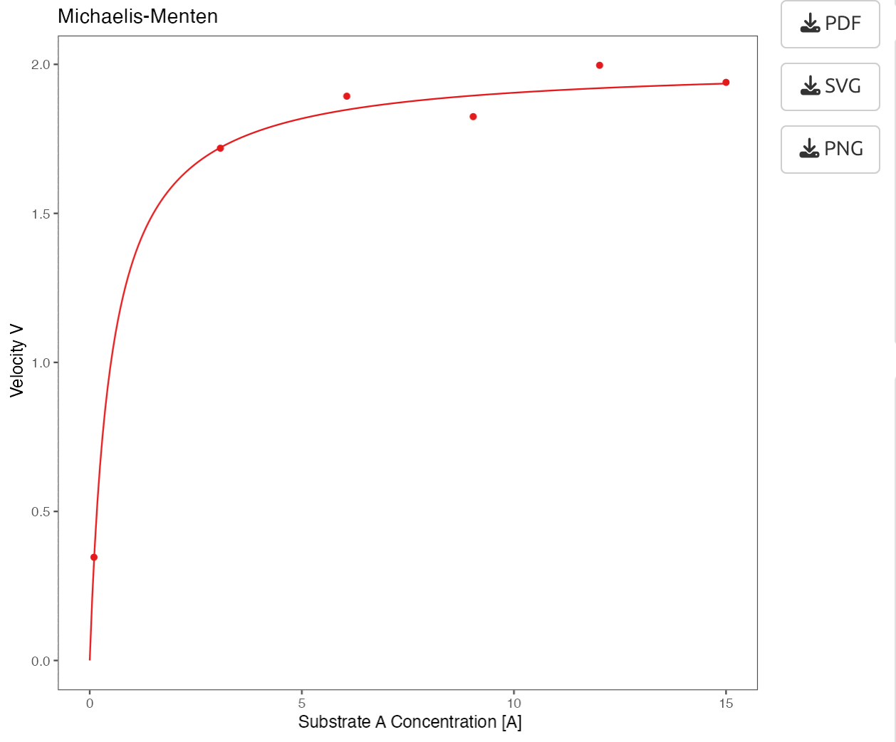{.eka-shot width=629}

Because EKA2 knows the parameters the data was simulated from, **Show true curve (of simulated data)** in Plot Options draws that original curve in black, so you can see how close a fit gets to the truth.

## Uploading data

To analyse your own measurements, drag a file onto the **Upload Data** box, or click **Browse**. EKA2 reads CSV, TSV and Excel (.xlsx, .xls) files, and TXT files separated by tabs. From an Excel file it reads the first sheet.

{.eka-shot width=309}

**Prepare your file:**

- One row per measurement, and one column per variable: for Michaelis-Menten, a column of substrate concentrations and a column of rates. Inhibition data also needs an inhibitor concentration column, two-substrate data a second substrate column, and so on. The [model gallery](../concepts/models.html) lists each model's variables.
- Replicates on separate rows.
- Columns in any order.
- Only numbers in every column, apart from the column names. A column of sample names or notes makes EKA2 reject the file, so remove such columns first. Other numeric columns are ignored.
- Initial rates. EKA2 fits initial rates, so work out the initial rate of each reaction before uploading.

**Match the columns.** After you choose a file, EKA2 guesses which column holds which variable from the column names, and shows a preview. Check the guesses, change any that are wrong, give the dataset a name, and click **Okay**.

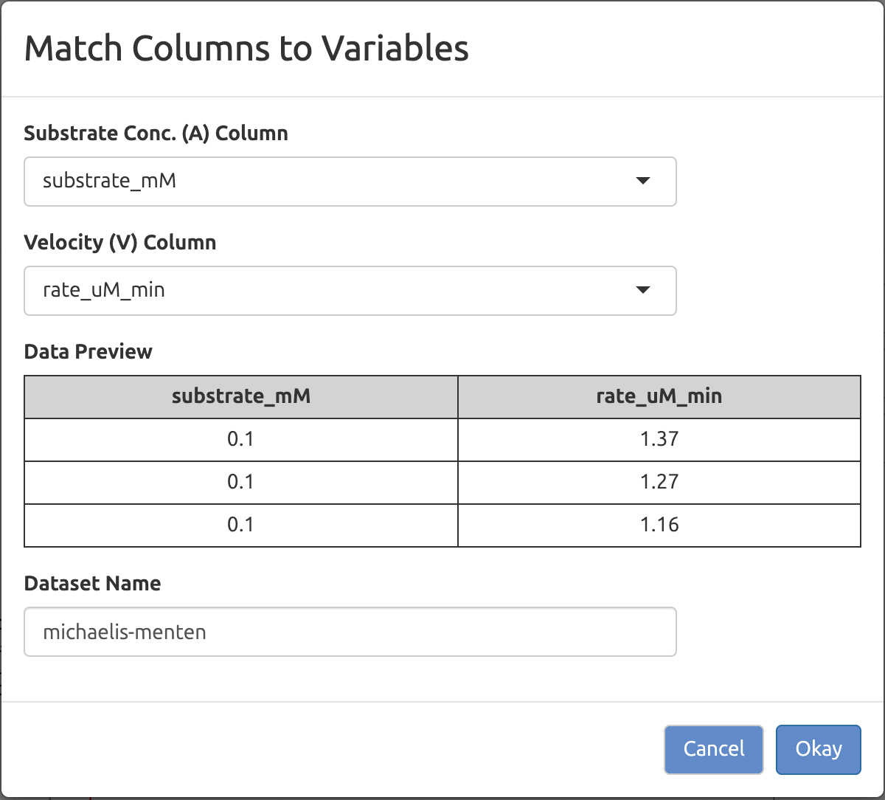{.eka-shot width=600}

**Checks.** EKA2 then checks the data against the model. The matched columns can't have empty cells; concentrations can't be negative (R must be above 0 for Quadratic Binding Kinetics); and rates can't be negative (fractions bound must be between 0 and 1). Rows with the same values in all the matched columns are kept only once, and there must be at least two different rows. If something is wrong, a message beneath the upload box says what.

To practise, download these sample files (simulated, so the true values are known):

- [michaelis-menten.csv](../../data/michaelis-menten.csv): substrate concentrations (mM) and rates (µM/min). True Km = 0.8 mM, Vmax = 12 µM/min.
- [inhibition.csv](../../data/inhibition.csv): substrate (mM), inhibitor (µM) and rate (µM/min) for a mixed inhibitor. True Km = 0.8 mM, Vmax = 12 µM/min, Kic = 20 µM, Kiu = 60 µM.

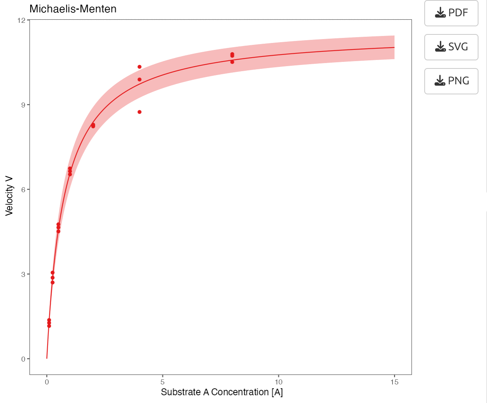{.eka-shot width=629}

## Fitting a model

The **Fit Model to Data** panel fits the current model to the current data.

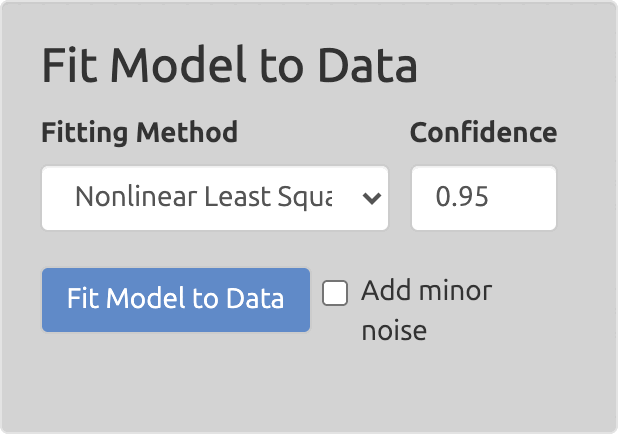{.eka-shot width=309}
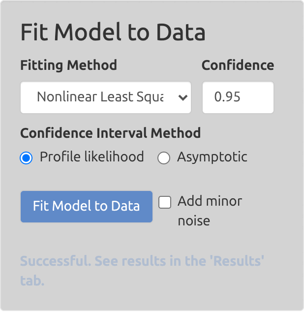{.eka-shot width=309}

- **Fitting Method:** **Nonlinear Least Squares** works for every model. Michaelis-Menten also has three methods that need no starting values (**Sum of Squares Calculation**, **Nonparametric** and **Recursive Solve**), but they don't give confidence intervals or statistics. See [Fitting](../concepts/fitting.html#methods-for-michaelis-menten-only).
- **Confidence:** the confidence level for the intervals, 0.95 by default.
- **Confidence Interval Method** (Advanced Mode): **Profile likelihood** (the default, and always used in Basic Mode) or **Asymptotic**. See [Confidence intervals](../concepts/fitting.html#confidence-intervals).
- **Add minor noise:** adds a negligible amount of noise before fitting. Nonlinear least squares fails on data that fits the model perfectly, such as data simulated with no noise, and this fixes it.

Click **Fit Model to Data**. Nonlinear least squares starts from the current slider values, so if a fit fails, move the sliders until the curve is roughly near the data and try again. When the fit succeeds, a message says so, the sliders move to the fitted values, and the result is added to the Results tab.

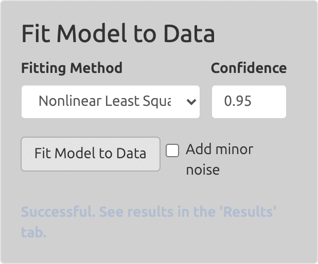{.eka-shot width=309}

The shaded band around the fitted curve is the **parameter uncertainty envelope**: the curves with each parameter at the ends of its confidence interval. It's shown while the sliders hold the fitted values; moving a slider hides it. It isn't a confidence band for the curve: see [The parameter uncertainty envelope](../concepts/fitting.html#the-parameter-uncertainty-envelope).

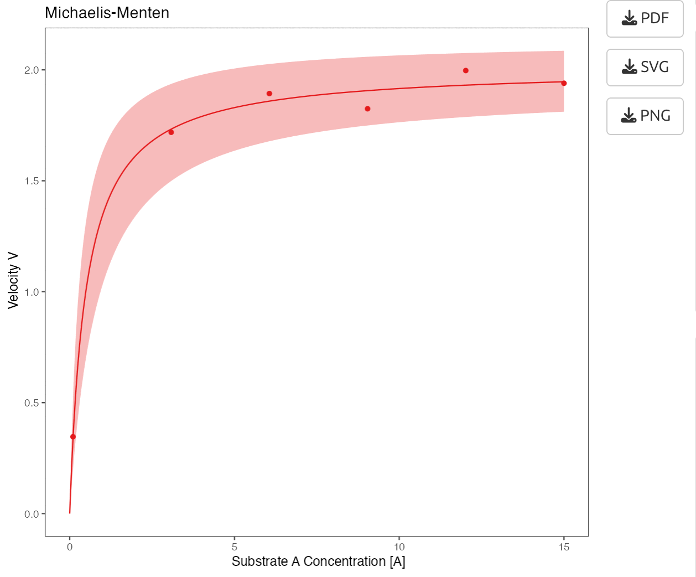{.eka-shot width=629}

If a fit fails, or its confidence intervals can't be calculated, a message explains and the fit isn't added to the results. [Fitting and confidence intervals](../concepts/fitting.html) explains the common causes, and the [FAQ](faq.html) has fixes.

## Results

The **Results** tab lists every successful fit in this session: the dataset, time, model, method, confidence interval method, fitted parameters, R² and RMSE. **Bounds & Errors Columns** adds each parameter's confidence bounds and standard error, and **Extra Stats Columns** adds the confidence level, MAE, AIC, BIC and the log-likelihood. To compare models fitted to the same data, look at AIC and BIC: lower is better (see [Comparing models](../concepts/fitting.html#comparing-models)).

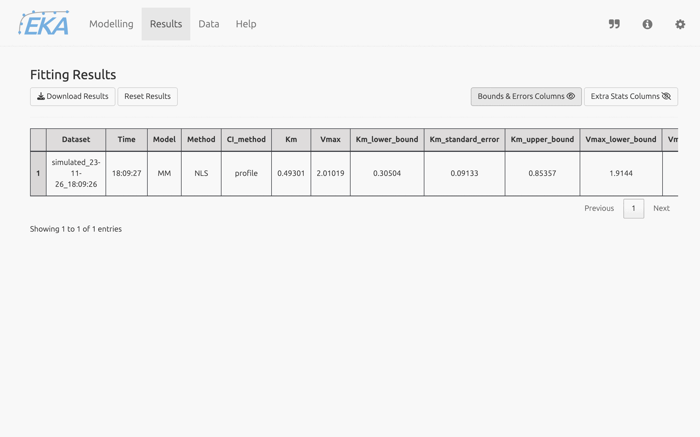{.eka-shot width=100%}

**Download Results** saves the whole table, unrounded, as a CSV file. **Reset Results** clears it.

## Plots

The **Plot Options** panel controls the plots. In Basic Mode it has:

- **Show true curve (of simulated data):** the curve the data was simulated from, in black.
- **Plot x-axis maximum:** how far the x-axis extends (it always covers the data).
- **X Variable Units** and **Y Variable Units:** added to the axis labels. On transformed plots, the units shown are those of the plotted quantity (for example 1/mM on a Lineweaver-Burk plot). The menus offer a fixed list of common units; for others, write them into a custom axis label in Advanced Mode.

Advanced Mode adds **Select Plot**, to choose the plot type; **Hide confidence envelope**; **Show grids on plots**; **Hide plot legend**; a **Plot Colour Palette**; and a custom **Plot Title**, **X-axis Label** and **Y-axis Label**.

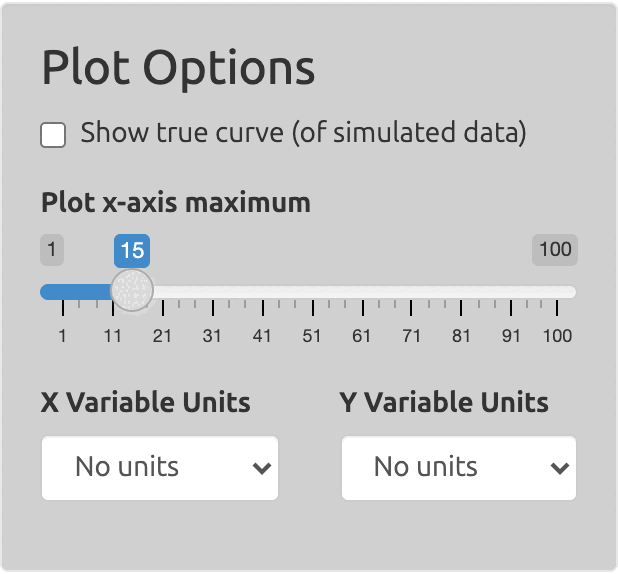{.eka-shot width=309}
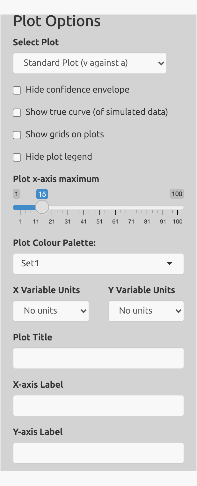{.eka-shot width=309}

**Plot types** (Advanced Mode): the standard plot, a log10 plot, and the Lineweaver-Burk, Hanes, Eadie-Hofstee and direct linear plots. The data and the curve are transformed together, so each plot shows the fitted model. The plot shown never changes the fit. Not every plot suits every model. The direct linear plot is for Michaelis-Menten data only, and appears in the menu once there is data. [Plot types](../concepts/plots.html) explains each one.

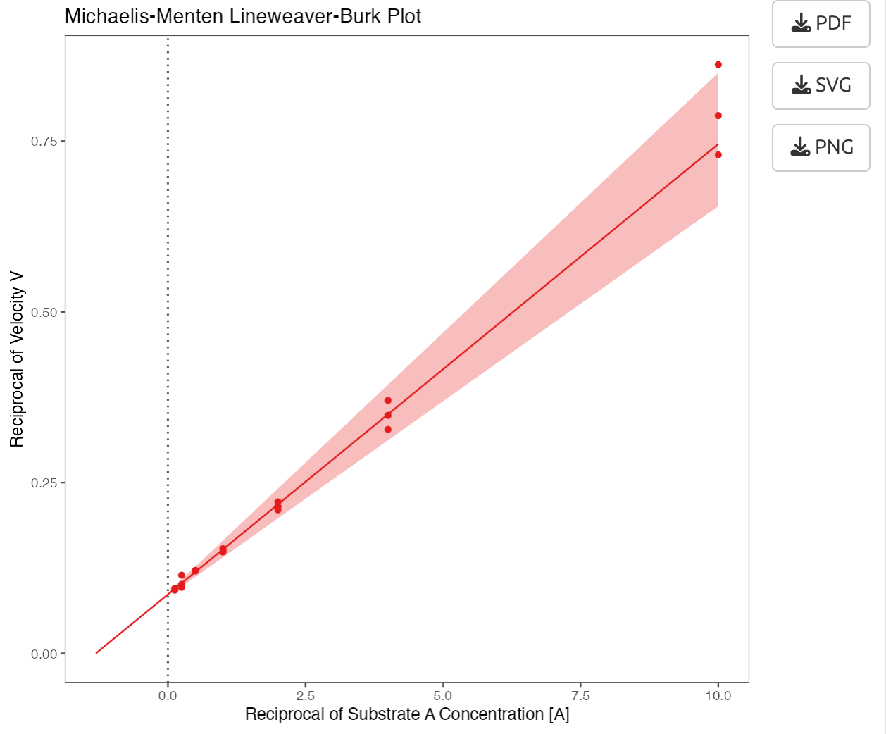{.eka-shot width=440}
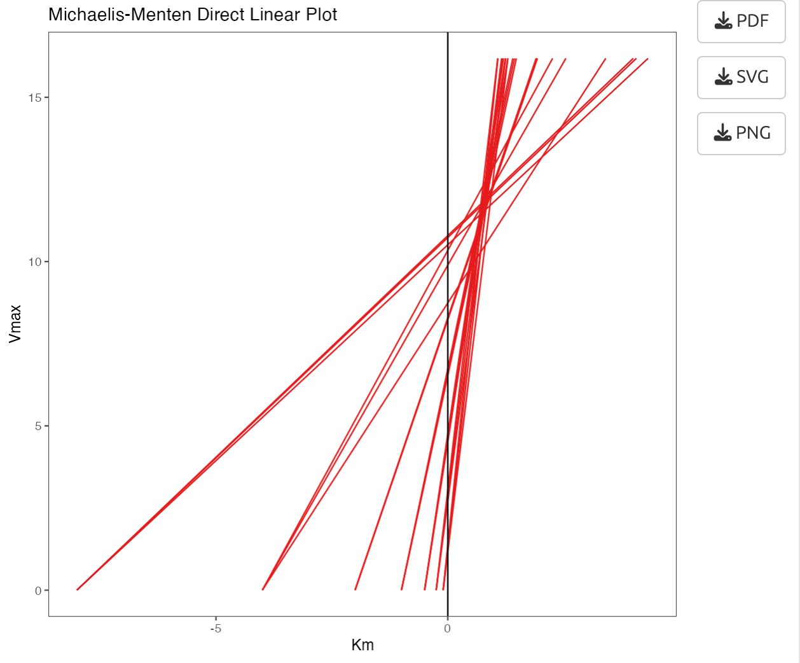{.eka-shot width=440}

**The residual plot** appears beneath the main plot whenever there is data. It shows each point's residual, its value minus the curve's, at the current parameter values. After a good fit the residuals scatter evenly around zero, while a pattern suggests the model doesn't describe the data.

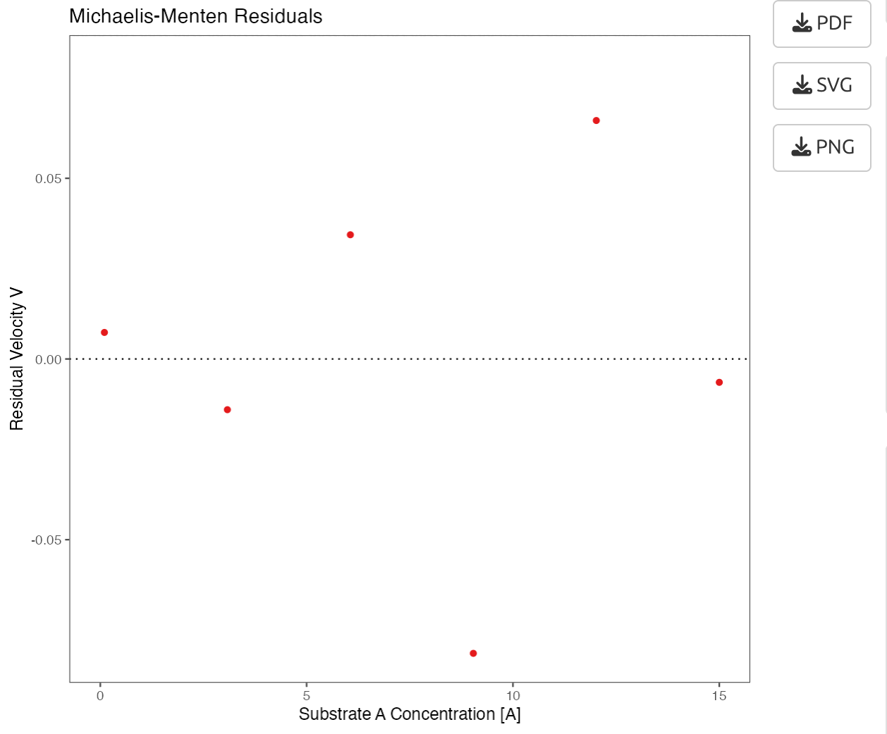{.eka-shot width=629}

## Exporting plots

The **PDF**, **SVG** and **PNG** buttons beside each plot download it. PDF and SVG are vector formats, best for publications and posters. PNG is an image (at 120 dpi). Set the export size, in inches (12 × 8 by default), under **Options**.

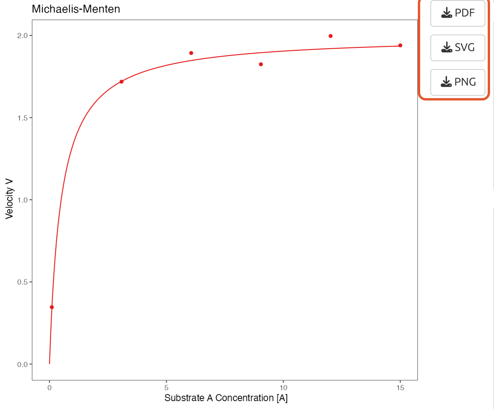{.eka-shot width=629}

## The Data tab

The **Data** tab shows the current data as a table, with its details (such as the dataset name and, for simulated data, the parameters used). **Download Data** saves it as a CSV file, with the model's variable names as column names; **Discard Data** removes it.

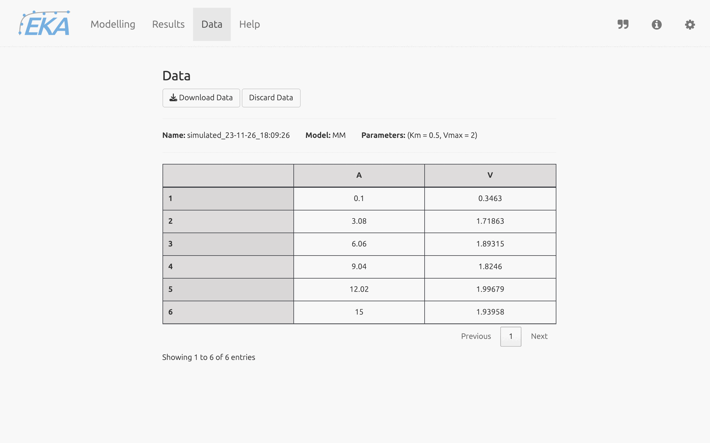{.eka-shot width=100%}

## Advanced Mode

Open **Options** (the cog at the top right) and switch on **Advanced Mode**. It adds:

- Original Michaelis-Menten and Alternative Michaelis-Menten to the models.
- Noise type, noise distribution and a maximum noise setting for simulation.
- Locking parameters while fitting.
- The confidence interval method.
- Plot types, the envelope, grid and legend options, colour palettes, and custom titles and labels.

Switching Advanced Mode off returns these settings to their defaults, so nothing you can't see affects your results. **Options** also sets the size of exported plots.

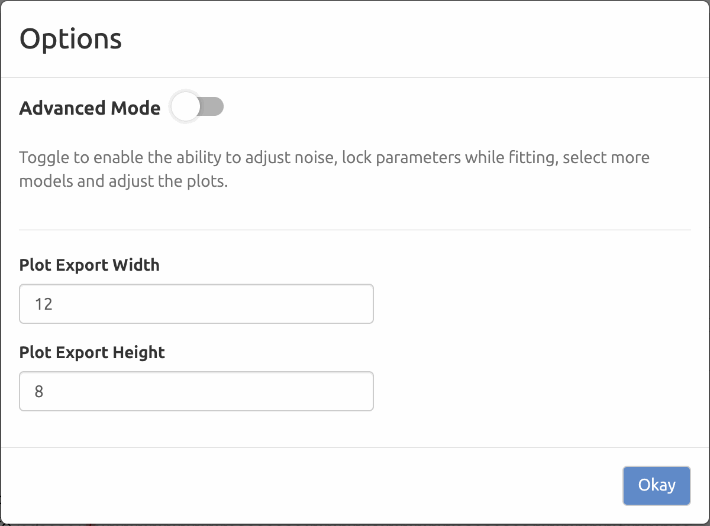{.eka-shot width=440}
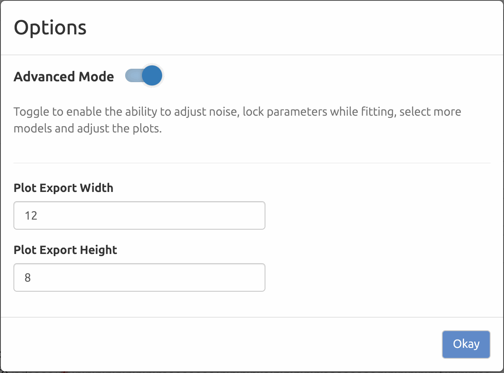{.eka-shot width=440}

## Citing EKA2, About and Help

**How to cite** (the quotation-mark button) gives the citation for EKA in several formats, ready to copy or download for a reference manager. **About** lists the authors and links to the paper, enzKinet2 and these docs. The **Help** tab has a short summary of the models and features, and links here.

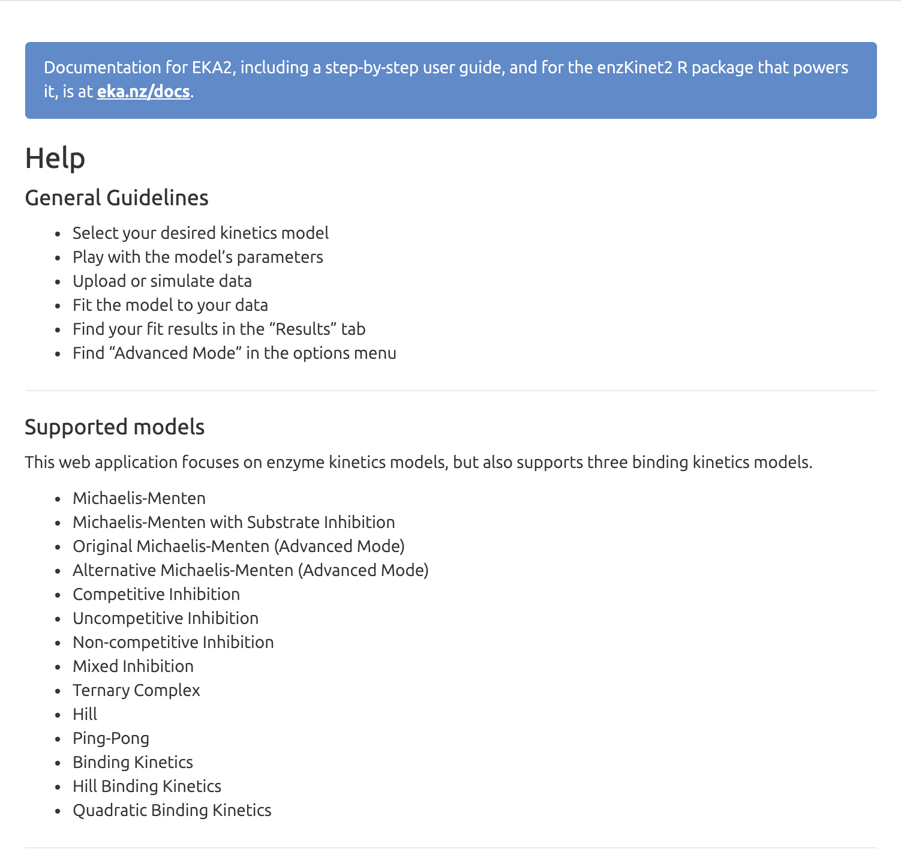{.eka-shot width=600}

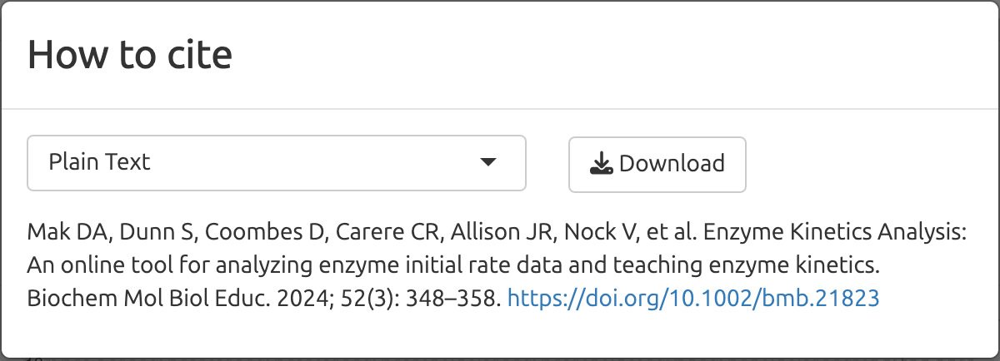{.eka-shot width=440}
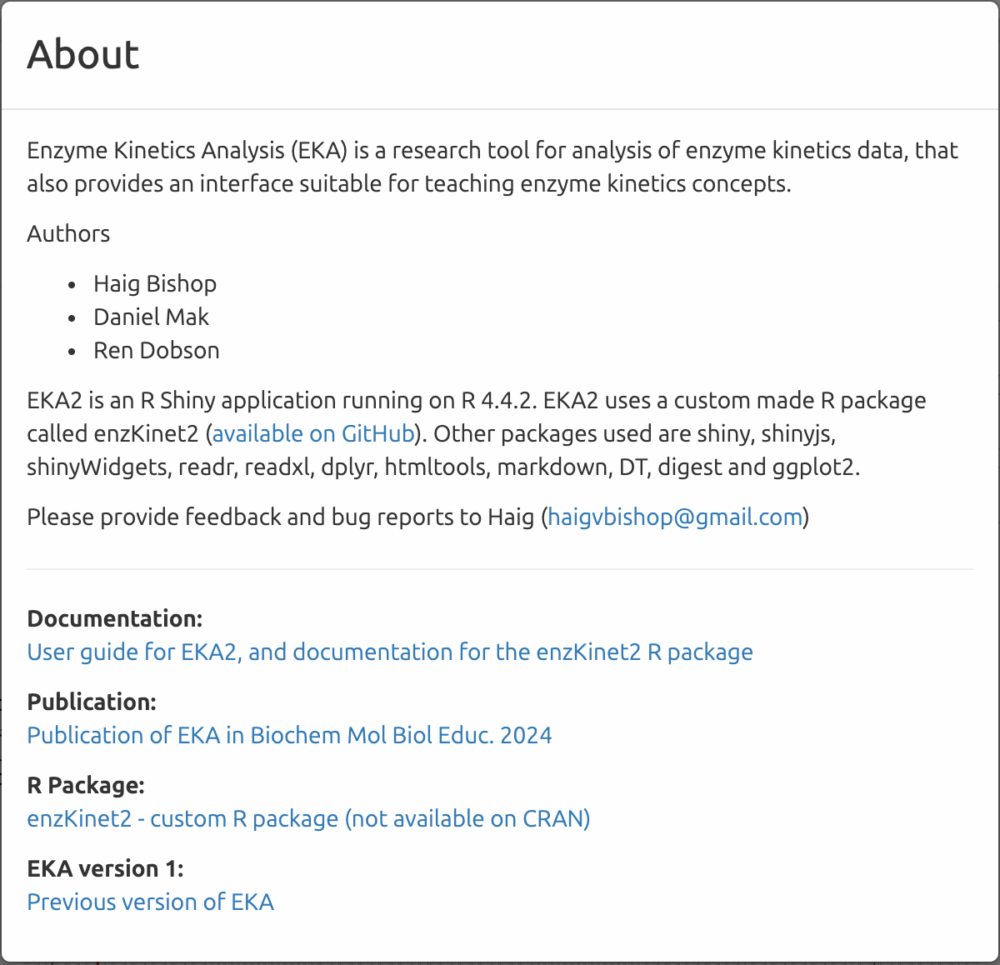{.eka-shot width=440}

## Going further

- The same analyses in R, with full control: [Reproducing an EKA2 analysis in R](../r/reproducing-eka2.html) and [Get started with enzKinet2](../enzKinet2.html).
- Ideas for classes: [Teaching with EKA2](teaching.html).
- Questions and problems: the [FAQ](faq.html), or email <haigvbishop@gmail.com>.
